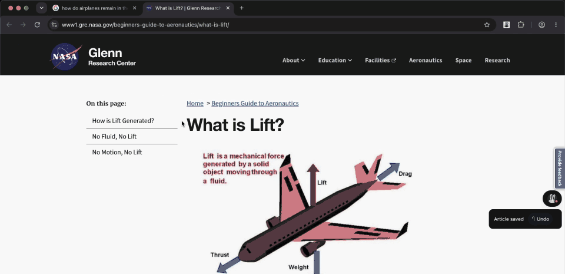
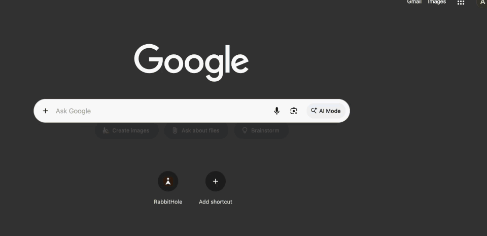
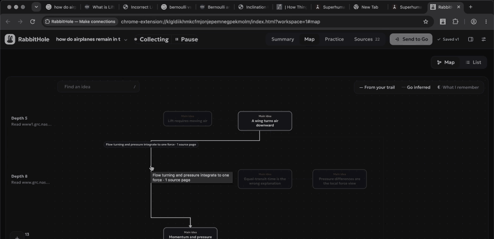
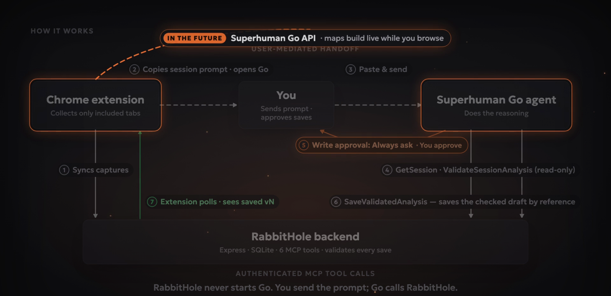
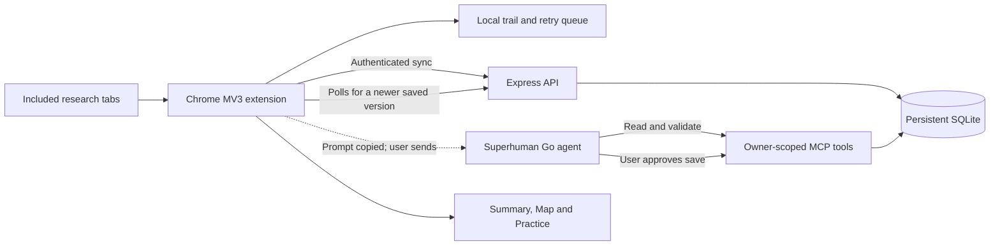

<p align="center">
  <picture>
    <source media="(prefers-color-scheme: dark)" srcset="docs/media/rabbithole-mark-dark.svg">
    
  </picture>
</p>
<h1 align="center">RabbitHole</h1>
<p align="center"><b>Keep the trail. Find the connection.</b></p>
<p align="center">
  <a href="https://youtu.be/zytJ4YJhMho">RabbitHole Demo</a> · <a href="#how-it-works">How it works</a> ·
  <a href="#getting-started">Getting started</a> · <a href="docs/architecture.md">Architecture</a> ·
  <a href="../../issues">Issues</a>
</p>

<p align="center">
  RabbitHole is a Chrome extension that collects your research only when you ask.
  Start a session and browse naturally: it keeps searches, readable articles and highlights
  while you focus on reading and following questions.
</p>
<p align="center">
  Superhuman Go reasons over the captured trail through RabbitHole’s MCP tools to build an
  evidence-linked map. Practice asks you to use the ideas, and Markdown export keeps your
  saved guide and source links portable.
</p>

## See it in action

[Watch the RabbitHole Demo](https://youtu.be/zytJ4YJhMho) for the complete walkthrough, including Go approval, inferred connections and practice.

### Capture while you read

Included articles and selected passages join your research trail with lightweight confirmation.



### Revisit the trail

Searches, articles and highlights stay together in the session’s source trail.



### Inspect the evidence

Select a supported connection to inspect its saved quotation and source.



## How it works





| Component                 | Responsibility                                                                      |
| ------------------------- | ----------------------------------------------------------------------------------- |
| `apps/extension`          | Scoped capture, durable queue, reading widget, workspace and deterministic practice |
| `apps/server`             | Owner authentication, six MCP tools, atomic validation and SQLite persistence       |
| `packages/contracts`      | Shared runtime schemas; optional additions preserve older sessions                  |
| `integrations/superhuman` | Connector definition and canonical agent instructions                               |
| `tests`                   | Model, worker, authenticated MCP and packaged-extension browser regressions         |

Go owns generative reasoning. The server does not fetch arbitrary source URLs or run another LLM. Source IDs, quotations and versions are checked before a save; those checks cannot prove the semantic truth of a generated explanation. See [architecture and data guarantees](docs/architecture.md) and [tradeoffs](docs/design.md).

### Go handoff

The current connector uses discovery schema **8**.

MCP lets **Go call RabbitHole's tools**. It does not itself let the extension start a Go conversation. This implementation has no verified supported external invocation API, so it copies the precise prompt, opens Go and waits for an actual saved backend version. Opening a tab is never reported as completed generation. Writes retain **Always ask** approval.

The public Go builder now documents beta features and triggers. We have not established that those features provide an authenticated third-party extension invocation path for this project; private or partner capabilities may differ. The [design guide](docs/design.md#go-invocation-confirmed-scope-and-uncertainty) records the sources and this uncertainty. A supported invocation adapter is a future improvement, rather than an undocumented endpoint workaround.

## Research at your own pace

1. **Follow a real question.** Start a rabbit hole with an optional goal and include the tabs you want to collect. Search, open articles, go back and follow another lead. Observable child tabs can inherit their included opener; unrelated tabs need explicit inclusion.
2. **Keep reading.** Searches and enabled article capture build the trail as you browse. Save a passage with a highlight shortcut or opt into automatic selection highlights. The bunny provides lightweight feedback without requiring the sidebar to stay open.
3. **Stay in control.** Pause collection, exclude a page, remove an accidental find or use the quick Article saved Undo. Article collection is configurable. Google Overview captures are labeled as AI-generated, and their linked pages are not treated as independently read.
4. **Reflect when you are ready.** Send the collected session to Go for a guide grounded in the captured material. Inspect an idea or relationship alongside its evidence, distinguish inference from direct support, and optionally check your understanding in Practice. These features build on the trail you researched.
5. **Return or take it with you.** Reopen a session with its original start date, sources and progress. Export a saved guide as Markdown, study material as an Anki CSV or Quizlet import text, or the complete session as JSON.

## Why preserve the research process?

Choosing sources, comparing competing explanations and working through an unfamiliar mechanism are meaningful parts of the activity. RabbitHole is designed to reduce the bookkeeping around that work: remembering where you went, saving useful passages and reconstructing the trail after the tabs close.

You choose the questions and read the sources. Go then helps organize what you explored, surface connections and give you something to revisit. RabbitHole keeps source discovery, reading and judgment in your hands, with AI available for reflection when you want it.

| When it is useful                      | What the captured trail gives you                                                                |
| -------------------------------------- | ------------------------------------------------------------------------------------------------ |
| Learning an unfamiliar technical topic | The searches, explanations and useful passages that helped you build an understanding            |
| Investigating a decision               | A source-linked record of the options, tradeoffs and unanswered questions you encountered        |
| Following an unexpected curiosity      | A way to preserve a spontaneous investigation without turning every page into a note-taking task |
| Writing or sharing findings            | A portable guide with source links you can inspect, edit and use in your own work                |

## Exports

After a guide is saved, **Markdown export** carries its summary, takeaways, idea explanations, available idea evidence quotations, quiz questions and visible non-search source titles and links into a text file. You can keep it in a Markdown-compatible editor, a project repository or another workflow that accepts text. Idea cross-links use wiki-link syntax, whose rendering depends on the destination; the source URLs remain ordinary links.

The guide stays useful outside RabbitHole. Keep reading, annotate it yourself, share it or use it as context in a different workflow. You do not have to use every in-house feature to benefit from collecting the session.

For the complete selected session, **JSON export** preserves the raw captured text and searches, analysis and attempts. JSON is also available before Go has generated a guide. Exports are one-way today; RabbitHole does not yet import them or guarantee native round-trip compatibility with other applications.

## Getting started

Requires Node **22.20+** and Chrome **120+**.

```sh
npm ci
npm run setup:local
npm run check
npm start
```

Setup creates an ignored `.env` with a random personal token and leaves existing configuration intact. The server defaults to `http://localhost:3210`; ignored `data/rabbithole.sqlite` holds the database.

1. Open `chrome://extensions`, enable Developer mode, choose **Load unpacked**, and select `dist/extension` from this checkout.
2. Open RabbitHole on a research tab. In Settings enter the backend URL, your token from `.env` and your saved Go agent URL. Grant website access when prompted.
3. Start a session and confirm captures sync. Article collection is configurable; searches and manual highlights still work when it is off. Use Alt+Shift+H for a selection, or the selection context menu. Chrome shortcuts can be reassigned.
4. For Go generation, deploy a reachable HTTPS backend and configure the connector using the [setup guide](docs/setup.md). Go cannot reach your localhost. The extension and Go must use credentials for the same owner.

After rebuilding an installed unpacked extension, **Reload** its Chrome extensions card and refresh research/Go tabs. Browser restart preserves sessions but pauses collection and clears tab bindings. Resume and explicitly include your current research tab. Hiding the bunny does not pause capture.

| Shortcut    | Action                         |
| ----------- | ------------------------------ |
| Alt+Shift+R | Open the RabbitHole side panel |
| Alt+Shift+M | Open the expanded workspace    |
| Alt+Shift+H | Save the selected text         |
| Alt+Shift+B | Hide or show the reading bunny |

Shortcuts can be reassigned at `chrome://extensions/shortcuts`.

## Tests

```sh
npm run check          # types, regression tests, production build
npm run lint           # formatting
npx playwright install chromium
npm run test:release   # check + lint + all packaged-extension browser suites
git diff --check
```

Set `CHROMIUM_PATH` to an existing Chromium executable when needed. See [development guide](docs/development.md) for suite boundaries and [manual acceptance checks](docs/testing.md#manual-acceptance) for live acceptance. Browser fixtures use temporary profiles and test-only permissions; they do not verify real Go instruction-following or native permission dialogs. Screenshots and private audit output remain ignored.

## Tradeoffs and next steps

- Explicit tab inclusion favors user control over capturing all browser history. Opener lineage indicates browsing continuity, not topic relevance.
- A durable local queue supports temporary disconnection; permanent HTTP failures remain visible and can require intervention. Device storage is finite.
- SQLite on a persistent disk keeps the prototype small and transactional; it requires one service instance. Static personal tokens need manual provisioning and rotation.
- Practice checks saved keys and records confidence/hints. It is not a measured learning-gain claim or a spaced-repetition scheduler. Content quality needs a real-source review.
- Captures are bounded to 12,000 characters, sessions to 300 finds, and guides to 40 activities. Google Overview extraction depends on the current DOM; manual selection is the fallback.

The [roadmap](docs/design.md#future-improvements) covers broader capture support, local-file input, spaced review, portability, processing quality and stronger operations. None is represented as shipped.

## Documentation

- [Setup and deployment](docs/setup.md)
- [Architecture and data guarantees](docs/architecture.md)
- [Design decisions and future improvements](docs/design.md)
- [Development](docs/development.md)
- [Testing](docs/testing.md)

## License

RabbitHole is released under the [MIT License](LICENSE). Contributions, forks and improvements are welcome. Dependency notices are in [THIRD_PARTY.md](THIRD_PARTY.md) and [THIRD_PARTY_LICENSES.txt](THIRD_PARTY_LICENSES.txt).
