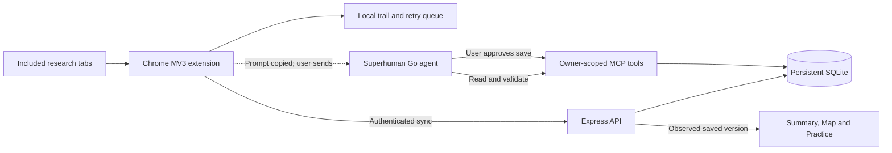

# RabbitHole

**Keep the trail. Find the connection.**

You can spend an hour following links and still struggle to explain how the ideas fit together. Browser history remembers addresses. A chat summary remembers what you pasted. RabbitHole preserves an intentionally collected research trail, turns its sources into an evidence-linked map with Superhuman Go, and helps you test what you can explain afterward.

A Chrome extension collects searches, articles and highlights. Go synthesizes the material and writes learning activities through an authenticated MCP connector. RabbitHole stores the guide, links claims back to sources, and keeps practice progress across visits. No separate LLM API key is required.

**Demo candidate — October 29, 2026.** The [release status](docs/status.md) distinguishes automated evidence from the final live rehearsal. The current connector uses schema **8**. See the [documentation index](docs/README.md) for setup, design decisions and dated evaluations.

## The experience

1. **Research intentionally.** Start a named rabbit hole, include research tabs and follow links. Pause, exclude pages or remove accidental finds. The compact bunny lets you read without keeping a sidebar open; Article saved offers a quick Undo.
2. **Make the connections.** Send to Go copies a session-specific prompt and opens your configured agent. Paste/send it, let Go inspect the actual captures, then approve a validated save. A newer saved version ends the waiting state; any unprocessed finds remain clearly counted.
3. **Inspect the reasoning.** Summary explains mechanisms, implications and gaps. Map organizes main ideas and their details, with a reading route and source drawer. Dashed connections are Go inferences; supported connections link to captured evidence. Layout never manufactures a relationship.
4. **Practise deliberately.** Choose a topic, New questions, Review misses or eligible medium/hard practice. Checked answers save immediately. Retry variants are kept separate from unanswered original questions. Request more questions with a topic, count and difficulty selection.
5. **Return later.** Session previews retain original start dates and sort by recent use or updates. Your trail, saved guide and attempts persist; JSON export keeps a portable record.

Real demo clips will be added after the final live rehearsal and recording. Generated test fixtures are not presented as Go output.

## Why the Go handoff is explicit

MCP lets **Go call RabbitHole's tools**. It does not itself let the extension start a Go conversation. This implementation has no verified supported external invocation API, so it copies the precise prompt, opens Go and waits for an actual saved backend version. Opening a tab is never reported as completed generation. Writes retain **Always ask** approval.

The public Go builder now documents beta features and triggers. We have not established that those features provide an authenticated third-party extension invocation path for this project; private or partner capabilities may differ. [Platform findings](docs/platform-findings.md) records the sources and this uncertainty. A supported invocation adapter is a future improvement, rather than an undocumented endpoint workaround.

## Architecture



| Component                 | Responsibility                                                                      |
| ------------------------- | ----------------------------------------------------------------------------------- |
| `apps/extension`          | Scoped capture, durable queue, reading widget, workspace and deterministic practice |
| `apps/server`             | Owner authentication, six MCP tools, atomic validation and SQLite persistence       |
| `packages/contracts`      | Shared runtime schemas; optional additions preserve older sessions                  |
| `integrations/superhuman` | Connector definition and canonical agent instructions                               |
| `tests`                   | Model, worker, authenticated MCP and packaged-extension browser regressions         |

Go owns generative reasoning. The server does not fetch arbitrary source URLs or run another LLM. Source IDs, quotations and versions are checked before a save; those checks cannot prove the semantic truth of a generated explanation. See [architecture](docs/architecture.md), [data guarantees](docs/data-flow.md) and [tradeoffs](docs/decisions.md).

## Run locally

Requires Node **22.20+** and Chrome **120+**.

```sh
npm ci
npm run setup:local
npm run check
npm start
```

Setup creates an ignored `.env` with a random personal token and leaves existing configuration intact. The server defaults to `http://localhost:3210`; ignored `data/rabbithole.sqlite` holds the database.

1. Open `chrome://extensions`, enable Developer mode, choose **Load unpacked**, and select `dist/extension` from this checkout.
2. Open RabbitHole on a research tab. In Settings enter the backend URL, your token from `.env` and your saved Go agent URL. Grant website access when prompted.
3. Start a session and confirm captures sync. Article collection is configurable; searches and manual highlights still work when it is off. Use Alt+Shift+H for a selection, or the selection context menu. Chrome shortcuts can be reassigned.
4. For Go generation, deploy a reachable HTTPS backend and configure the connector using [deployment](docs/deployment.md) and [agent setup](docs/go-agent-setup.md). Go cannot reach your localhost. The extension and Go must use credentials for the same owner.

After rebuilding an installed unpacked extension, **Reload** its Chrome extensions card and refresh research/Go tabs. Browser restart preserves sessions but pauses collection and clears tab bindings. Resume and explicitly include your current research tab. Alt+Shift+B restores a hidden bunny; hiding it does not pause capture.

## Verify

```sh
npm run check          # types, regression tests, production build
npm run lint           # formatting
npx playwright install chromium
npm run test:release   # check + lint + both browser suites + Stage 3 + reload
git diff --check
```

Set `CHROMIUM_PATH` to an existing Chromium executable when needed. See [maintenance](docs/maintenance.md) for suite boundaries and [release checklist](docs/release-checklist.md) for live acceptance. Browser fixtures use temporary profiles and test-only permissions; they do not verify real Go instruction-following or native permission dialogs. Screenshots and private audit output remain ignored.

## Tradeoffs and next steps

- Explicit tab inclusion favours user control over capturing all browser history. Opener lineage indicates browsing continuity, not topic relevance.
- A durable local queue supports temporary disconnection; permanent HTTP failures remain visible and can require intervention. Device storage is finite.
- SQLite on a persistent disk keeps the prototype small and transactional; it requires one service instance. Static personal tokens need manual provisioning and rotation.
- Practice checks saved keys and records confidence/hints. It is not a measured learning-gain claim or a spaced-repetition scheduler. Content quality needs a real-source review.
- Captures are bounded to 12,000 characters, sessions to 300 finds, and guides to 40 activities. Google Overview extraction depends on the current DOM; manual selection is the fallback.

[Future work](docs/future-work.md) covers supported Go invocation, richer quality evaluation, cross-session review, authentication and scale. None is represented as shipped.

## Demo and project notes

The [demo plan](docs/demo.md) maps features to a short genuine user journey and a later GIF capture list. [Learning design](docs/learning-design.md) explains what practice can and cannot establish. [Stage 4](docs/stage-4.md) records the fixes and verification history.

Repository publication and a project license still require the owner's decision; no project license has been granted. Third-party notices remain in [THIRD_PARTY.md](THIRD_PARTY.md) and [THIRD_PARTY_LICENSES.txt](THIRD_PARTY_LICENSES.txt). Local credentials, research databases, browser profiles and private screenshots must stay out of commits and demo footage.
