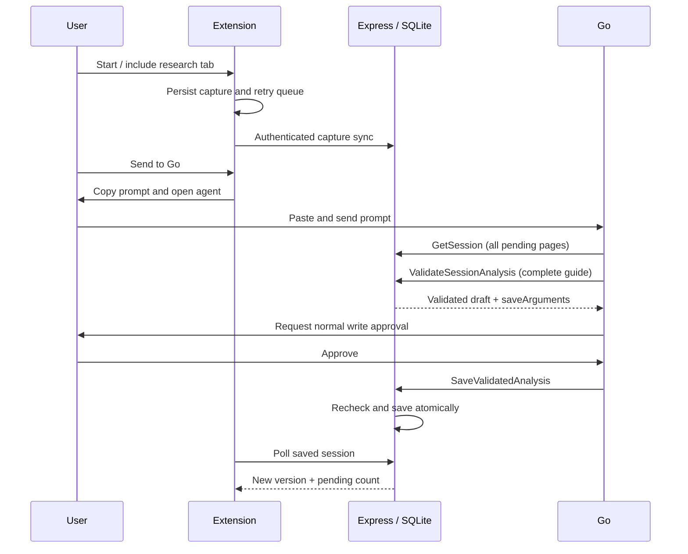

# Architecture

RabbitHole separates capture, generation and validation. The extension records a user-enabled trail; Go reasons over it; the backend validates and persists the result. No external LLM API or arbitrary-page fetcher runs in the backend.

## Boundaries

The content script sees the DOM but has no backend token. The MV3 worker owns tab scope, credentials, persisted queue and serialized mutations. Local storage survives worker suspension; browser-session bindings clear on browser restart, when collection pauses conservatively. The React side panel, workspace and options use one bundled entry point.

The Express API derives ownership from bearer authentication. SQLite transactions protect full analysis saves and question-only top-ups. A persistent disk and single instance are required. Source text is untrusted data, rendered as text rather than captured HTML. The guarantees and limits below describe provenance, deletion and retry behaviour.

## Go contract

Six tools are exposed: ListSessions, GetSession, ValidateSessionAnalysis, ValidateSessionQuestions, SaveValidatedAnalysis and legacy SaveSessionAnalysis. Read tools are read-only; both saves require confirmation. The connector stays at discovery schema 8. GetSession pages at twelve captures; Go follows nextOffset through the submitted trail, rather than treating a page as a processing limit.

Preflight does not mutate the guide or processed markers. It returns an owner/session-bound draft, held in bounded process memory for thirty minutes. Approval rechecks sources and version. A replay returns the original receipt; restart/expiry requires revalidation. Question-only drafts append to the stored guide using visible sources without erasing hidden evidence. Legacy full-payload saves remain compatible.

Invalid quotations stay invalid. Optional bounded evidenceRepairs offer exact same-source passages as correction data; Go must decide whether they support its claim and revalidate the complete guide. Successful structural validation is not semantic verification. New instructions explicitly allow corrected read-only preflights before approval. Real Go compliance remains a live test.

## Workspace and practice

Map layout measures cards and arranges source-depth rows with main-topic columns. Routing can bend around cards; dashed paths mean inferred relationships. Only saved edges are drawn. A graph-content key preserves layout during question-only saves and remeasures changed graphs even without a version increment. Publishing an asynchronous layout explicitly refreshes mounted handle measurements, preventing a controlled-node startup race from leaving cards visible but edges absent. Panning beyond a padded graph boundary returns toward the map on release. The accessible list and source drawer provide alternatives to graph navigation.

Practice assigns every question to one topic: nearest main ancestor, otherwise tree root for legacy ideas. New uses unanswered originals; review uses missed families and reserved siblings. Harder readiness requires solid basics and available medium/hard questions. The UI distinguishes saved, unlocked, unanswered and reserved counts. Quiz and matching attempts persist at check time; local-only stale attempts remain visible but are not counted as server-synced answers.

## Data guarantees

### Identity and source provenance

Random UUIDs identify sessions/captures/reviews. Owner comes only from bearer authentication. Captures retain URL, title, UTC timestamp, type, bounded actual text, optional parent capture, importance tag, and actually observed overview references. The browsing trail is chronological and separate from conceptual relationships. Child tabs are included when Chrome exposes an opener belonging to the active session; other tabs need Include current tab. Opener relationships express browsing continuity, not semantic relevance.

Tab bindings and last-capture context use Chrome storage.session: they survive worker suspension but clear on browser restart. On a fresh browser session active collection pauses before state is returned; old local tab IDs are never reused. The worker remembers the last capture per tab; captures carry its ID as context. This is a best-effort chronological link, not an assertion that one source verifies another. Full URLs are stored; use collection only on pages you intend to save. Text from form/editable fields is excluded before Readability parsing and selection capture. Automatic extraction is partial by design, not access-control bypass. No raw DOM or screenshots are retained.

Google query extraction uses a small explicit supported-host allowlist. Overview parsing requires an explicitly labeled visible region; many Google variants will not match. In that case use explicit selection; searches and articles continue working. The DOM observer only schedules Google extraction, debounces mutations, and a low-frequency URL check handles History API navigation. Article clones are parsed once per successful URL, excluding inputs, editable regions, scripts, forms, navigation, stylesheet-hidden elements and obvious consent banners. Repeated title/H1 text is joined with block whitespace without duplicating the title. Unprocessed Overview growth coalesces to the latest capture while preserving its search parent and deletion tombstones.

### Bounds

- 12,000 characters per capture, 20 observed outbound references.
- 300 captures/session; 100 sessions/owner; 2,000 review attempts/session.
- GetSession returns at most 12 pending captures, with offset or explicit evidence IDs. Go follows every nextOffset page for the submitted pending batch. Twelve is a response-size boundary, not a run cap.
- Analysis: 40 concepts, 70 edges, 40 study items; tool POST body limit 750 KB.
- Extension storage.local has a browser quota shared by sessions and retry data. New capture storage is conservatively capped below the browser quota with a visible warning and toolbar badge. Use bounded research sessions; export/delete old sessions. It is not an unlimited local archive. A full storage device/quota can prevent a capture from being saved; do not treat a page load as capture success.

### Retry and concurrency

Every queue item is persisted before attempted transmission. A single worker chain serializes mutations; a one-minute Chrome alarm retries, and user actions trigger sync. The queue survives worker suspension. Restart does not depend on a permanent timer or the in-memory chain. HTTP timeouts leave failed items queued. Session creation, capture and review retries use stable IDs. Capture dedup uses type + URL + text + tag hash, preserving identical text from different URLs. An ID cannot be reused with different content. Local dedup uses the same key fields.

The analysis uses optimistic versioning. The complete payload and all graph/evidence/quiz references are validated before mutation. A transaction updates the map, processed capture IDs, analysis timestamp and preference snapshot. Older writes fail with 409. Only explicitly processed IDs are marked; later arrivals remain pending. Existing reviewed activities keep their attempt records, including the old analysis version. Old concept order is retained for stable layout. Named session titles are preserved; only the default “New rabbit hole” adopts the first generated guide title. Incremental saves retain visible citations and verified quotes for unchanged questions/answer keys, including when hints or feedback improve. Explicit rebuilds may intentionally replace citations. Hidden/deleted sources are never restored by this merge, and citation limits still apply without silent truncation. Content quality and preserving meaningful IDs remain Go's responsibility; structural validation does not prove a claim is true.

A stale review fails rather than grading a changed activity. Checked quiz and matching attempts are persisted locally before delivery. On a review POST returning 409, the extension marks the attempt localOnly, shows a non-blocking note, and removes that queued POST so later captures and edits can sync. That optional marker is browser-only and never sent to the server. Other failed requests remain queued and retain their sync error even after a successful refresh. Those failures can still require user intervention.

### Deletion and export

Export downloads the selected local session as JSON, including sources, analysis, and study attempts. Sync first for the latest backend analysis. Delete removes the local session, clears pending mutations for it, removes tab associations, and queues a server DELETE. If offline, this deletion is retried; remote data remains until sync succeeds. Refresh skips locally pending deletes, preventing resurrection. A capture targeting a deleted server session is rejected. Host backups may retain historical data until their retention expires. Tokens are never included in session exports.

There is no export import feature or automated backup restore UI. Personal tokens and SQLite files are ignored by Git. Operational console logs contain event names, counts, status, and versions, never source text or bearer tokens. These logs follow the host's retention rather than a separate durable processing-audit database.

### Local display metadata

Optional browser-only sessionLastUsed records recent meaningful use and is never sent as server session data. Session previews sort by recent use/server update but display the original createdAt. Refresh preserves an earlier local start when an offline session first synced later. Question requests and layout revisions do not rewrite start dates. A handoff completes when the saved version advances; its receipt counts processed submitted finds separately from still-pending finds. Deleted-find failures count only submitted captures that remain present and unprocessed, including hidden finds.
