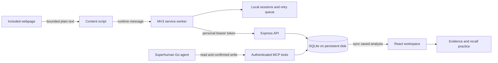

# Architecture

A search for “How GPUs work” is recorded only while the user has enabled a session on that tab. The content script recognizes the URL, creates a bounded capture, and sends it to the worker. The worker checks the tab/session relationship and pause state, deduplicates it, persists it locally, then queues an authenticated POST. An alarm or the UI’s refresh retries delivery. The API validates the capture and writes it to SQLite under the authenticated owner.

Send to Go copies a precise prompt when possible and opens the configured agent URL. The user sends it. Go calls GetSession, reasons about concepts and relationships, and proposes SaveSessionAnalysis. The backend rejects invented evidence IDs and stale versions. One SQLite transaction saves the valid analysis and processed markers. A new capture added during reasoning stays pending. The extension polls for saved results (every four seconds during a handoff; every thirty seconds otherwise). Only an observed new version produces the updated state.

The content script can see the page DOM but has no backend token. The service worker has authentication and tab scope, but no generative model. The backend persists and validates; it never fetches arbitrary source URLs or calls an external LLM. The connector exposes exactly three tools. Go performs all generative reasoning. The UI handles reveal, deterministic multiple-choice checking, and self-rating; fresh feedback explicitly hands off to Go.

The same React entry point is the side panel, full-page workspace, and options page. React Flow defaults to a radial reading guide: a saved main idea, major branches and progressively revealed details. A deterministic fallback organizes older maps from their existing relationships, labelled as a layout choice. Only saved edges are drawn; hierarchy placement is not evidence. An alternate chronological view places chambers at their earliest evidence capture, with distinct rows 150px apart. Static tunnels distinguish supported and inferred relationships. It provides pan, zoom, fit, and keyboard focus; a separate list allows exploring concepts and edges without relying on the graph. Rich saved output can include exact excerpts, examples, limitations, an overview and a reading route. The backend validates excerpt provenance and hierarchy as well as graph references. Explicit rebuilds may enrich already-processed sources using version protection; ordinary no-new-content runs remain no-ops. Quiz and matching are checked against saved answer keys; open responses remain optional self-assessment or a separate Go handoff.

SQLite is appropriate for a small, single-instance buildathon service with a mounted durable disk. This is not a horizontally scalable, multi-device browser-history service.
