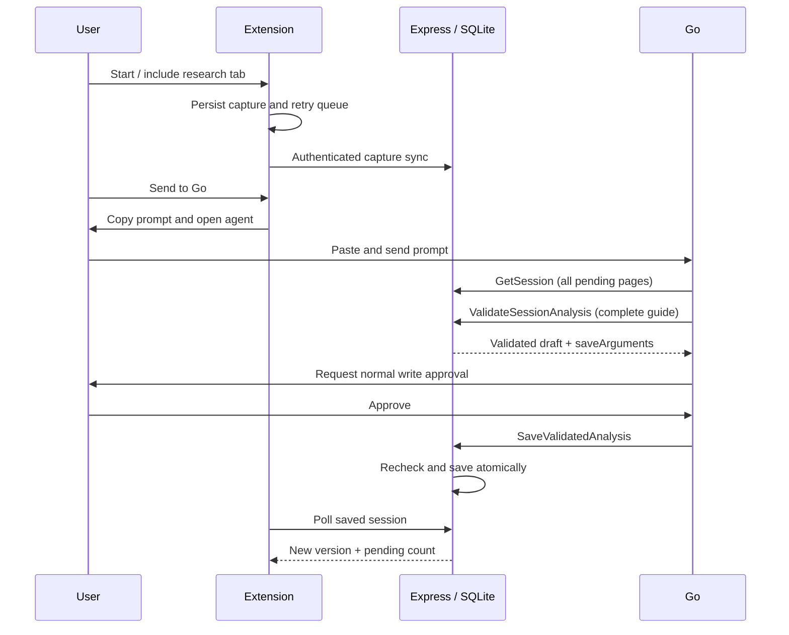

# Architecture

RabbitHole separates capture, generation and validation. The extension records a user-enabled trail; Go reasons over it; the backend validates and persists the result. No external LLM API or arbitrary-page fetcher runs in the backend.

## Boundaries

The content script sees the DOM but has no backend token. The MV3 worker owns tab scope, credentials, persisted queue and serialized mutations. Local storage survives worker suspension; browser-session bindings clear on browser restart, when collection pauses conservatively. The React side panel, workspace and options use one bundled entry point.

The Express API derives ownership from bearer authentication. SQLite transactions protect full analysis saves and question-only top-ups. A persistent disk and single instance are required. Source text is untrusted data, rendered as text rather than captured HTML. See [data flow](data-flow.md) for limits, deletion and retry guarantees.

## Go contract

Six tools are exposed: ListSessions, GetSession, ValidateSessionAnalysis, ValidateSessionQuestions, SaveValidatedAnalysis and legacy SaveSessionAnalysis. Read tools are read-only; both saves require confirmation. The connector stays at discovery schema 8. GetSession pages at twelve captures; Go follows nextOffset through the submitted trail, rather than treating a page as a processing limit.

Preflight does not mutate the guide or processed markers. It returns an owner/session-bound draft, held in bounded process memory for thirty minutes. Approval rechecks sources and version. A replay returns the original receipt; restart/expiry requires revalidation. Question-only drafts append to the stored guide using visible sources without erasing hidden evidence. Legacy full-payload saves remain compatible.

Invalid quotations stay invalid. Optional bounded evidenceRepairs offer exact same-source passages as correction data; Go must decide whether they support its claim and revalidate the complete guide. Successful structural validation is not semantic verification. New instructions explicitly allow corrected read-only preflights before approval. Real Go compliance remains a live test.

## Workspace and practice

Map layout measures cards and arranges source-depth rows with main-topic columns. Routing can bend around cards; dashed paths mean inferred relationships. Only saved edges are drawn. A graph-content key preserves layout during question-only saves and remeasures changed graphs even without a version increment. Publishing an asynchronous layout explicitly refreshes mounted handle measurements, preventing a controlled-node startup race from leaving cards visible but edges absent. Panning beyond a padded graph boundary returns toward the map on release. The accessible list and source drawer provide alternatives to graph navigation.

Practice assigns every question to one topic: nearest main ancestor, otherwise tree root for legacy ideas. New uses unanswered originals; review uses missed families and reserved siblings. Harder readiness requires solid basics and available medium/hard questions. The UI distinguishes saved, unlocked, unanswered and reserved counts. Quiz and matching attempts persist at check time; local-only stale attempts remain visible but are not counted as server-synced answers.

## Deployment boundaries

A Git merge/deploy updates the backend. Rebuilding/reloading updates the extension. Live agent Instructions must be pasted separately from this checkout. A connector release is needed only for a tool-contract/discovery change; this batch does not change schema 8. See [setup](go-agent-setup.md), [decisions](decisions.md) and [release checklist](release-checklist.md).
